# Rancangan arsitektur TK 2

## Keputusan lingkup

Pertanyaan TK 1 tetap RQ1 distribusi sentimen, RQ2 tema, dan RQ3 hubungan tema dengan sentimen untuk diskusi alokasi anggaran MBG 2027 pascapemaparan RKA BGN 3 September 2026. Sumber yang direncanakan adalah Threads dan YouTube (pengganti Reddit). **TK 2 hanya mengimplementasikan perolehan dan penyiapan dataset**, belum menjawab RQ dengan model analitik. Kode yang telah ada adalah kolektor YouTube. Kolektor Threads belum tersedia; kebutuhan dan metode pengaksesannya perlu diputuskan serta dibuktikan sebelum laporan mengklaim pipeline dua platform.

## Alur yang diimplementasikan

```mermaid
flowchart LR
    A["Pertanyaan penelitian + kueri/aturan di kode"] --> B["YouTube Data API v3: search.list"]
    B --> C["videos.list: metadata dan seleksi"]
    C --> D["Tinjau kandidat + catat video ditolak"]
    D --> E["commentThreads.list / comments.list: pagination"]
    E --> F["data/raw/<run_id>/youtube_api_responses.jsonl"]
    F --> G["Filter waktu/relevansi, deduplikasi, teks minimal"]
    G --> H["data/processed/<run_id>/mbg_2027_youtube_comments.csv"]
```

Komponen hanya dua skrip Python dan berkas lokal. `run_pipeline.py` membekukan salinan kode, input kandidat, versi dependensi, waktu, checksum, dan keluaran untuk setiap run. `youtubeAPI1-Vids.py` memanggil API, menulis respons JSON per permintaan berhasil, menyeleksi video, mengumpulkan komentar dan balasan, lalu menghasilkan CSV. Susunan `data/raw/`, `data/interim/`, dan `data/processed/` mengikuti slide penyimpanan; `data/external/` belum diperlukan. `<run_id>` pada ketiga folder menjadi identitas versi dataset dan menghubungkannya dengan `runs/<run_id>/manifest.json`. Tidak ada perubahan skema untuk model analisis; `content_id` menjadi kunci sambungan RQ1–RQ3 kelak.

## Peta kebutuhan data untuk C1

| Kebutuhan | Atribut tersedia | Kegunaan dan batas |
| --- | --- | --- |
| Unit opini untuk RQ1–RQ3 | `content_id`, `text`, `content_type`, `parent_id`, `depth` | Teks komentar/balasan menjadi unit analisis; tanpa label sentimen/topik pada TK 2. |
| Konteks kebijakan | `video_id`, `video_title`, `video_anchors`, `matched_budget_kw`, `post_budget` | Menilai relevansi anggaran 2027; pemeriksaan manual tetap diperlukan. |
| Waktu dan asal | `created_at` (UTC), `platform`, `permalink`, `post_permalink` | Menyaring periode dan melacak sumber; tautan dapat mati bila konten dihapus. |
| Keterlibatan sederhana | `like_count` | Metadata tambahan, bukan sampel representatif atau ukuran dukungan publik. |

Periode minimal: video dan komentar sejak **2026-09-03 UTC** sampai saat koleksi. Tidak ada filter geografis yang dapat membuktikan lokasi penulis komentar; `regionCode=ID` dan `relevanceLanguage=id` hanya mengarahkan pencarian video. Target `TOTAL_CAP=3500`, `PER_VIDEO_CAP=500`, `MAX_VIDEOS=60` adalah batas teknis, bukan volume yang dijamin. Dataset historis di `data/processed/legacy/mbg_2027_youtube_comments.csv` saat ini berisi 1.730 baris dari 43 video, tetapi tidak mempunyai bukti raw/manifest run dan perlu dilaporkan terpisah dari run baru.

## Metode untuk C2–C4

- Pencarian `search.list` menggunakan daftar kueri di kode, `publishedAfter`, `order=viewCount`, `regionCode=ID`, `relevanceLanguage=id`, maksimum 50 item per halaman dan `SEARCH_PAGES=3`. ID video dideduplikasi sebelum `videos.list` mengambil snippet/statistik.
- Video harus menyebut MBG/BGN di judul atau tag, memiliki penanda konteks anggaran 2027 dan istilah anggaran. Ada daftar pengecualian manual dan ambang 10 komentar. Simpan alasan penolakan dari `rejected_youtube.csv`, serta alasan pemilihan akhir di catatan penelitian.
- `commentThreads.list` mengambil komentar terbaru, `comments.list` mengambil balasan yang tidak seluruhnya disertakan. Kolektor menghentikan halaman saat mencapai komentar lama; komentar akhir disaring tanggal, konteks balasan, istilah anggaran untuk video yang gagal aturan, duplikasi `content_id`, dan panjang teks minimal 15 karakter. Teks menghapus `@mention` dan merapikan spasi; teks raw ada di JSONL privat.
- Kunci API berasal dari environment variable. Kegagalan jaringan/API dicetak dan dihitung; kuota habis dapat menghasilkan dataset parsial. Tidak ada retry otomatis atau checkpoint/resume, sehingga laporan harus menuliskan keterbatasan tersebut. Hindari menyatakan seluruh komentar video telah tercakup.

## Jejak asal, kualitas, etika untuk C5–C6

`runs/<run_id>/manifest.json` mencatat waktu run, mode, versi Python/pustaka, checksum input dan output, serta status proses. Salinan kolektor menyimpan seluruh aturan, daftar kueri, dan batas. `data/raw/<run_id>/youtube_api_responses.jsonl` menyimpan respons yang berhasil beserta endpoint/parameter tanpa API key. Daftar kandidat/penolakan berada di `data/interim/<run_id>/`; dataset akhir berada di `data/processed/<run_id>/mbg_2027_youtube_comments.csv`. Nama file menjelaskan topik, tahun, platform, dan unit data; versi ada pada folder `run_id`. Rantai audit: CSV processed ← kode dan CSV pilihan video ← respons API raw. Berkas run bersifat privat dan tidak ditimpa.

Keterbatasan utama: pencarian mengutamakan video berkomentar banyak dan `viewCount`, ada batas video/komentar, komentar yang sudah dihapus atau dinonaktifkan tidak diperoleh, istilah kunci bisa salah memasukkan atau membuang konten, dan pengguna YouTube tidak mewakili seluruh masyarakat Indonesia. Balasan pendek tanpa konteks dibuang. Pengambilan lintas waktu tidak menghasilkan snapshot ulang yang identik karena data platform berubah. Untuk laporan, tampilkan jumlah pada setiap tahap seleksi, jumlah null/duplikat, rentang waktu, serta contoh false positive/negative dari tinjauan manual.

Hanya komentar publik yang dibutuhkan untuk RQ yang dikumpulkan. Dataset olahan tidak menyimpan nama akun atau ID penulis, tetapi raw API dapat memuatnya; batasi akses dan retensi. Jangan publikasi raw atau kutipan yang membuat pengguna dapat diidentifikasi tanpa pertimbangan etika dan ketentuan platform. `permalink` dan ID konten tetap berpotensi menghubungkan ke pengguna sehingga pertimbangkan apakah keduanya perlu ada dalam dataset yang dibagikan.

## Pekerjaan minimum yang masih diperlukan

1. Jalankan satu proses `discover` lalu tinjau serta catat seleksi kandidat.
2. Jalankan satu proses `collect` yang terdokumentasi; laporkan apakah parsial dan hitung kualitas data.
3. Putuskan sumber/izin/metode Threads dan buat kolektor ringkas dengan format inti yang sama bila penelitian tetap menyatakan dua platform. Jika tidak sempat, revisi klaim cakupan laporan menjadi YouTube saja serta jelaskan penyimpangannya dari TK 1.
4. Masukkan diagram, tabel C1, hasil nyata, keterbatasan, dan etika ke template laporan TK 2; ekspor PDF.
